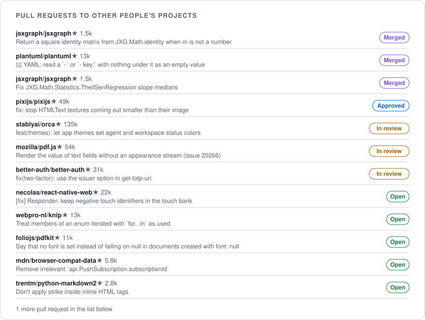

<!-- profile:start -->

<a href="https://github.com/search?q=is%3Apr%20author%3AalphaNumericEntity%20-user%3AalphaNumericEntity&type=pullrequests"><picture><source media="(prefers-color-scheme: dark)" srcset="assets/dark/hero.svg"></picture></a>
<a href="https://github.com/alphaNumericEntity?tab=repositories"><picture><source media="(prefers-color-scheme: dark)" srcset="assets/dark/projects.svg"></picture></a>
<a href="https://github.com/search?q=is%3Apr%20author%3AalphaNumericEntity%20-user%3AalphaNumericEntity&type=pullrequests"><picture><source media="(prefers-color-scheme: dark)" srcset="assets/dark/contributions.svg"></picture></a>

<b>Every pull request, with links</b>

 

| Project | Pull request | Status |
|---|---|---|
| [plantuml/plantuml](https://github.com/plantuml/plantuml) ★13k | [🐛 YAML: read a `-` or `- key:` with nothing under it as an empty value](https://github.com/plantuml/plantuml/pull/3038) | Merged 2026-11-23 |
| [jsxgraph/jsxgraph](https://github.com/jsxgraph/jsxgraph) ★1.5k | [Fix JXG.Math.Statistics.TheilSenRegression slope medians](https://github.com/jsxgraph/jsxgraph/pull/856) | Merged 2026-11-23 |
| [pixijs/pixijs](https://github.com/pixijs/pixijs) ★49k | [fix: stop HTMLText textures coming out smaller than their image](https://github.com/pixijs/pixijs/pull/12412) | Approved |
| [mozilla/pdf.js](https://github.com/mozilla/pdf.js) ★54k | [Render the value of text fields without an appearance stream (issue 20266)](https://github.com/mozilla/pdf.js/pull/22541) | In review |
| [better-auth/better-auth](https://github.com/better-auth/better-auth) ★31k | [fix(two-factor): use the issuer option in get-totp-uri](https://github.com/better-auth/better-auth/pull/12637) | In review |
| [necolas/react-native-web](https://github.com/necolas/react-native-web) ★22k | [\[fix\] Responder: keep negative touch identifiers in the touch bank](https://github.com/necolas/react-native-web/pull/2965) | Open |
| [webpro-nl/knip](https://github.com/webpro-nl/knip) ★13k | [Treat members of an enum iterated with `for...in` as used](https://github.com/webpro-nl/knip/pull/2460) | Open |
| [foliojs/pdfkit](https://github.com/foliojs/pdfkit) ★11k | [Say that no font is set instead of failing on null in documents created with font: null](https://github.com/foliojs/pdfkit/pull/1867) | Open |
| [trentm/python-markdown2](https://github.com/trentm/python-markdown2) ★2.8k | [Don't apply strike inside inline HTML tags](https://github.com/trentm/python-markdown2/pull/786) | Open |
| [cantoo-scribe/pdf-lib](https://github.com/cantoo-scribe/pdf-lib) ★364 | [Measure standard font text without kerning, as drawText draws it](https://github.com/cantoo-scribe/pdf-lib/pull/182) | Open |

<!-- profile:end -->

### The projects

**[PDFAirlock](https://pdfairlock.com)**: PDF tools that run entirely in your browser. Merge, split, compress, redact, sign, protect and convert, with no upload step anywhere.

- **You don't have to trust it.** The site ships a `connect-src 'self'` Content-Security-Policy, so the browser itself refuses to send your file to any other host. It also works with the network off.
- **Redaction that actually removes text.** Marked pages are rebuilt, then the output is re-opened and checked, and you get a report of what the check could and couldn't prove. A companion tool finds text still sitting under someone else's black boxes.
- Next.js static export, pdf.js, qpdf compiled to WebAssembly, and a service worker. [Source](https://github.com/alphaNumericEntity/pdfairlock), AGPL-3.0.

**[pdf-redaction-check](https://github.com/alphaNumericEntity/pdf-redaction-check)**: PDFAirlock's redaction checker as a Node library and CLI. It reports text under black boxes, unapplied Redact annotations, and removed text still sitting in a PDF's earlier saved versions. Its exit codes let it fail a CI job before a leaky PDF ships. MIT.

**[no-phone-home](https://github.com/alphaNumericEntity/no-phone-home)**: fails CI when a web page can contact a host you didn't allow. It reads the Content-Security-Policy the page actually serves and reports every way it still reaches out: fetch and WebSockets, scripts, pixels, frames, form posts and violation reports. MIT.

### What I work with

TypeScript, React and Next.js, Node.js, Go, Kotlin and Java (Spring Boot), Python. Lately, a lot of PDF internals and browser security.

The panels above are rebuilt daily from GitHub by a workflow in this repo.
