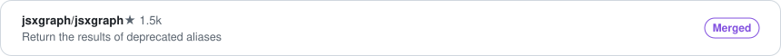

<!-- profile:start -->

<a href="https://github.com/search?q=is%3Apr%20author%3AalphaNumericEntity%20-user%3AalphaNumericEntity&type=pullrequests"><picture><source media="(prefers-color-scheme: dark)" srcset="assets/dark/hero.svg"></picture></a>
<a href="https://github.com/alphaNumericEntity?tab=repositories"><picture><source media="(prefers-color-scheme: dark)" srcset="assets/dark/projects.svg"></picture></a>
<picture><source media="(prefers-color-scheme: dark)" srcset="assets/dark/contributions-title.svg"></picture>
<a href="https://github.com/mdn/content/pull/46706"><picture><source media="(prefers-color-scheme: dark)" srcset="assets/dark/prs/mdn-content-46706.svg"></picture></a>
<a href="https://github.com/pixijs/pixijs/pull/12412"><picture><source media="(prefers-color-scheme: dark)" srcset="assets/dark/prs/pixijs-pixijs-12412.svg"></picture></a>
<a href="https://github.com/jsxgraph/jsxgraph/pull/860"><picture><source media="(prefers-color-scheme: dark)" srcset="assets/dark/prs/jsxgraph-jsxgraph-860.svg"></picture></a>
<a href="https://github.com/jsxgraph/jsxgraph/pull/858"><picture><source media="(prefers-color-scheme: dark)" srcset="assets/dark/prs/jsxgraph-jsxgraph-858.svg"></picture></a>
<a href="https://github.com/webpro-nl/knip/pull/2460"><picture><source media="(prefers-color-scheme: dark)" srcset="assets/dark/prs/webpro-nl-knip-2460.svg"></picture></a>
<a href="https://github.com/mdn/browser-compat-data/pull/31247"><picture><source media="(prefers-color-scheme: dark)" srcset="assets/dark/prs/mdn-browser-compat-data-31247.svg"></picture></a>

<b>1</b> &nbsp;·&nbsp; <a href="https://github.com/alphaNumericEntity/alphaNumericEntity/blob/main/pages/prs-2.md">2</a> &nbsp;·&nbsp; <a href="https://github.com/alphaNumericEntity/alphaNumericEntity/blob/main/pages/prs-3.md">3</a> &nbsp;·&nbsp; <a href="https://github.com/alphaNumericEntity/alphaNumericEntity/blob/main/pages/prs-4.md">4</a> &nbsp;·&nbsp; <a href="https://github.com/alphaNumericEntity/alphaNumericEntity/blob/main/pages/prs-2.md">Next →</a>

<!-- profile:end -->

### The projects

**[PDFAirlock](https://pdfairlock.com)**: PDF tools that run entirely in your browser. Merge, split, compress, redact, sign, protect and convert, with no upload step anywhere.

- **You don't have to trust it.** The site ships a `connect-src 'self'` Content-Security-Policy, so the browser itself refuses to send your file to any other host. It also works with the network off.
- **Redaction that actually removes text.** Marked pages are rebuilt, then the output is re-opened and checked, and you get a report of what the check could and couldn't prove. A companion tool finds text still sitting under someone else's black boxes.
- Next.js static export, pdf.js, qpdf compiled to WebAssembly, and a service worker. [Source](https://github.com/alphaNumericEntity/pdfairlock), AGPL-3.0.

**[pdf-redaction-check](https://github.com/alphaNumericEntity/pdf-redaction-check)**: PDFAirlock's redaction checker as a Node library and CLI. It reports text under black boxes, unapplied Redact annotations, and removed text still sitting in a PDF's earlier saved versions. Its exit codes let it fail a CI job before a leaky PDF ships. MIT.

**[no-phone-home](https://github.com/alphaNumericEntity/no-phone-home)**: fails CI when a web page can contact a host you didn't allow. It reads the Content-Security-Policy the page actually serves and reports every way it still reaches out: fetch and WebSockets, scripts, pixels, frames, form posts and violation reports. MIT.

### What I work with

TypeScript, React and Next.js, Node.js, Go, Kotlin and Java (Spring Boot), Python. Lately, a lot of PDF internals and browser security.

The panels above are rebuilt daily from GitHub by a workflow in this repo.
