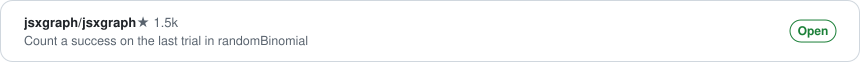
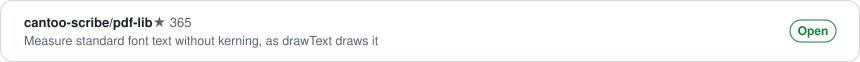

<picture><source media="(prefers-color-scheme: dark)" srcset="../assets/dark/contributions-title.svg"></picture>
<a href="https://github.com/WebReflection/linkedom/pull/370"><picture><source media="(prefers-color-scheme: dark)" srcset="../assets/dark/prs/WebReflection-linkedom-370.svg"></picture></a>
<a href="https://github.com/jsxgraph/jsxgraph/pull/863"><picture><source media="(prefers-color-scheme: dark)" srcset="../assets/dark/prs/jsxgraph-jsxgraph-863.svg"></picture></a>
<a href="https://github.com/cantoo-scribe/pdf-lib/pull/182"><picture><source media="(prefers-color-scheme: dark)" srcset="../assets/dark/prs/cantoo-scribe-pdf-lib-182.svg"></picture></a>

<a href="https://github.com/alphaNumericEntity/alphaNumericEntity/blob/main/pages/prs-3.md">← Previous</a> &nbsp;·&nbsp; <a href="https://github.com/alphaNumericEntity">1</a> &nbsp;·&nbsp; <a href="https://github.com/alphaNumericEntity/alphaNumericEntity/blob/main/pages/prs-2.md">2</a> &nbsp;·&nbsp; <a href="https://github.com/alphaNumericEntity/alphaNumericEntity/blob/main/pages/prs-3.md">3</a> &nbsp;·&nbsp; <b>4</b>

<a href="https://github.com/alphaNumericEntity">Back to the profile</a> · Page 4 of 4 · rebuilt daily from GitHub

